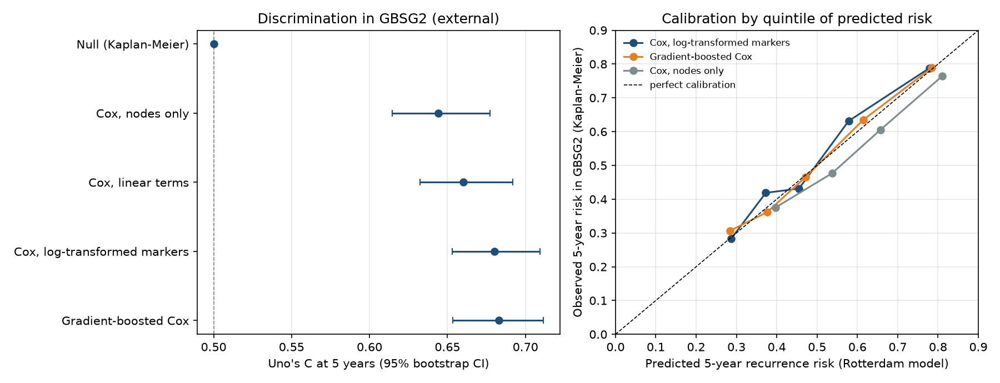

# Clinical-Trial Survival Analysis (GBSG2)

Two questions a trial statistician or clinical researcher planning a node-positive breast cancer study would ask. First, is adjuvant hormone therapy associated with longer recurrence-free survival once tumor biology and non-proportional hazards are handled properly? Second, can a recurrence-risk model built on one hospital's tumor bank (Rotterdam, n = 1,546) be used unchanged to stratify patients in a different trial population (GBSG2, n = 686), or does it need recalibrating first? The datasets are public and modest in size, so the project wins on modeling rigor: correct handling of non-proportional hazards, external validation and Python/R agreement to six digits.

## Key results

| Result | Estimate (95% CI) | Source |
|---|---|---|
| Hormone therapy HR, final model (grade-stratified, time-varying age, menopause, ER) | 0.71 (0.55 to 0.92), p = 0.0085 | `outputs/time_varying_sensitivity.csv` |
| Hormone therapy HR across four specifications | 0.63 to 0.71, every CI below 1 | `outputs/hormone_therapy_sensitivity.csv` |
| Proportional hazards, global test | p = 0.0071 (grade as a covariate); 0.40 for the final model | `outputs/ph_diagnostics.csv`, `outputs-r/final_model_ph.csv` |
| External validation in GBSG2: Uno's C at 5 years, log-marker Cox | 0.680 (0.653 to 0.709) | `outputs/external_validation.csv` |
| Same, gradient-boosted Cox / nodes only | 0.683 (0.653 to 0.712) / 0.644 (0.615 to 0.677) | `outputs/external_validation.csv` |
| Calibration in GBSG2, log-marker Cox: observed/expected 5-year risk; slope | 1.03 (0.94 to 1.12); 1.08 (0.90 to 1.28) | `outputs/external_validation.csv` |
| Brier skill vs no-model baseline (IPA), log-marker Cox | 12.8% (8.7 to 16.9%) | `outputs/external_validation.csv` |
| 5-year RFS, hormone therapy vs none (Kaplan-Meier) | 58.1% vs 43.7%, log-rank p = 0.0034 | `outputs/km_summary.csv` |



Kaplan-Meier curves and the full hazard-ratio forest plot are in [`figures/summary.png`](figures/summary.png).

## Approach

- **Kaplan-Meier estimation and log-rank tests** describe unadjusted recurrence-free survival by hormone therapy and tumor grade, with log-log confidence limits for medians and 5-year survival.
- **Cox proportional hazards regression** (Breslow ties) adjusts for age, menopausal status, tumor size, nodes and hormone receptors. Continuous-term HRs are reported per clinically readable unit.
- **Non-proportional hazards, handled in two steps.** Grambsch-Therneau score tests on log(time) flag grade (p = 0.0036), so the baseline hazard is **stratified by grade**. Age, menopausal status and estrogen receptor still fail, so the **final model adds x·log(t) time-varying coefficients** for those three, fitted on counting-process data split at every event time (identical to R's `coxph(tt = ...)`; likelihood-ratio test of the three terms p = 0.017). Refitted on the split data, the final model passes the global PH check (p = 0.40). The estimated ER hazard ratio moves from 0.95 per 100 fmol/mg at 1 year to 1.15 at 5 years (both CIs include 1; `outputs/time_varying_effects.csv`), so a single averaged ER hazard ratio describes neither period.
- **Functional form** is checked with likelihood-ratio tests of natural cubic splines and null-model martingale residual plots. Age, tumor size, nodes and progesterone receptor are nonlinear (p < 0.05), so a spline model is part of the sensitivity set.
- **Discrimination** within GBSG2 is measured with Harrell's C (0.674 apparent, 0.662 after Harrell's bootstrap optimism correction). DFBETAS screen for influential patients.
- **External validation (`external_validation.py`).** Models are developed on node-positive Rotterdam patients (censored at 7 years) and evaluated once on GBSG2, following the design Royston and Altman (2013, *BMC Med Res Methodol* 13:33) used with these two cohorts. Five models: no-model Kaplan-Meier baseline, nodes only, Cox with linear terms, Cox with prespecified log transforms of nodes and receptors, and a gradient-boosted Cox model tuned by 5-fold CV inside Rotterdam. Metrics: Harrell's and Uno's C, integrated Brier score and IPA, observed/expected risk, calibration slope and a quintile calibration plot, each with 500-resample bootstrap CIs.
- **Cross-language validation:** the R script (`survival`) reproduces every Python estimate, including the external Cox model, and the tests fail if they drift.
- **SAS (`sas/survival_analysis.sas`) is untested.** It specifies the same models in `PROC LIFETEST` and `PROC PHREG` but has never been run, because no SAS installation was available. Treat it as a translation, not a verified implementation.

## Data

**Validation and inference cohort:** `TH.data::GBSG2` ([documentation](https://rdrr.io/cran/TH.data/man/GBSG2.html); CRAN package `TH.data`, license GPL-3 per its [CRAN DESCRIPTION](https://cran.r-project.org/web/packages/TH.data/DESCRIPTION)), from the German Breast Cancer Study Group 2 trial (Schumacher et al., 1994; Sauerbrei and Royston, 1999). One row per patient: 686 women with node-positive breast cancer, 299 recurrences or deaths and 387 censored, followed for up to 7.3 years. Columns: `horTh` (hormone therapy), `age`, `menostat`, `tsize` (mm), `tgrade` (I to III), `pnodes`, `progrec` and `estrec` (fmol/mg), `time_days` and `event` (1 = recurrence or death). The only change from the source is renaming `time` and `cens`. See [DATA_PROVENANCE.md](DATA_PROVENANCE.md) for checksums.

**Development cohort:** `survival::rotterdam` (R `survival` 3.5-7, LGPL >= 2), 2,982 patients from the Rotterdam tumor bank operated 1978 to 1993, of whom the 1,546 node-positive patients are used. Recurrence-free survival is the first of recurrence or death. Rotterdam records grade only as 2 or 3, so GBSG2 grades I and II are combined for the external models, and GBSG2 tumor size is cut at 20 and 50 mm to match Rotterdam's categories.

## Repository structure

```
analysis.py                 GBSG2 pipeline (statsmodels): KM, Cox, PH handling, sensitivity
external_validation.py      Rotterdam -> GBSG2 external validation (scikit-survival)
r/survival_analysis.R       R implementation (survival), writes outputs-r/
sas/survival_analysis.sas   SAS translation (untested, see above)
survival_analysis.ipynb     Executed walkthrough of the results
tests/test_analysis.py      Invariants and Python/R parity tests
data/                       gbsg2.csv and rotterdam.csv
outputs/  outputs-r/        Generated tables and diagnostics
figures/                    Kaplan-Meier curves and forest plots
```

## Reproduce

```bash
python3.12 -m venv .venv && source .venv/bin/activate
pip install -r requirements.txt
python analysis.py
python external_validation.py   # about 5 minutes (GBM tuning + 500 bootstrap resamples)
Rscript r/survival_analysis.R --data data/gbsg2.csv --output-dir outputs-r   # optional, needs R + survival
pytest -q
jupyter nbconvert --to notebook --execute --inplace survival_analysis.ipynb
```

## Limitations

- Hormone therapy is analyzed as an observed covariate, so its hazard ratio is an adjusted association, not a causal treatment effect.
- The GBSG2 models keep linear terms for interpretability even though age, tumor size, nodes and progesterone receptor are nonlinear. A spline model moves the hormone therapy HR from 0.70 to 0.63, so the linear models are, if anything, conservative for that term.
- External validation uses only predictors recorded in both cohorts and merges grades I and II. GBSG2 patients all received chemotherapy, Rotterdam patients mostly did not, so the transport test is a demanding one.
- One patient with 51 positive nodes shifts the node coefficient by more than 1 SE (DFBETAS 1.18). Results include that patient.
- The SAS script has not been executed.

## Recommendation

- **Use the log-marker Cox model from Rotterdam to stratify GBSG2-like patients without recalibrating it.** Its 5-year risks were on target (observed/expected 1.03, CI 0.94 to 1.12; slope 1.08, CI 0.90 to 1.28) and it ranked patients better than nodes alone (Uno's C 0.680 vs 0.644).
- **Don't switch to gradient boosting for this problem.** It matched the Cox model (C 0.683; difference CI −0.008 to +0.014) while being harder to explain and audit; CV inside Rotterdam chose depth-1 trees, i.e. an additive model.
- **Model ER, age and menopausal status as time-varying** when hormone-receptor effects matter: their estimated effects change direction over follow-up, which a single averaged HR hides. The hormone therapy association (HR 0.71) is robust to every specification tried.
