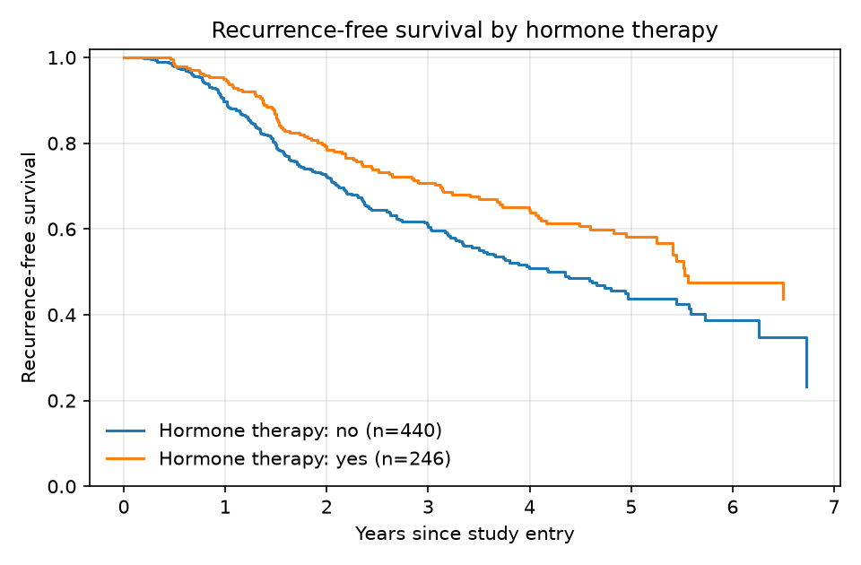

# Survival Analysis of a Breast-Cancer Trial (GBSG2)

Time-to-event analysis of the **German Breast Cancer Study Group 2 (GBSG2)**
trial — 686 node-positive breast-cancer patients followed for recurrence-free
survival. This is the standard workflow for reading out a clinical trial:
Kaplan-Meier estimation, log-rank group comparisons, and Cox proportional-hazards
regression for adjusted hazard ratios.

**The same analysis is implemented in three languages** to show tooling breadth:

| Language | File | Toolkit | Context |
|---|---|---|---|
| **Python** | `survival_analysis.ipynb` | `lifelines` | Executed here — plots & output rendered inline |
| **R** | `r/survival_analysis.R` | `survival` + `survminer` | The workflow I used at UC Irvine for publication figures |
| **SAS** | `sas/survival_analysis.sas` | `PROC LIFETEST` + `PROC PHREG` | The workflow I used at Pfizer for clinical-trial reporting |

> The Python notebook is executed with its outputs saved, so it renders on
> GitHub as-is. The R and SAS scripts are the equivalent implementations, ready
> to run in their environments (RStudio / SAS).

## Analysis

1. **Kaplan-Meier** — overall recurrence-free survival (median ≈ 1,807 days / 4.9 yrs)
2. **Log-rank tests** — hormonal therapy shows a significant survival benefit
   (p ≈ 0.003); tumor grade strongly stratifies survival (p < 0.001)
3. **Cox proportional-hazards** — adjusted hazard ratios (C-index ≈ 0.69);
   positive lymph nodes and tumor grade are the strongest adverse factors,
   hormonal therapy and progesterone-receptor level are protective
4. **Proportional-hazards diagnostics** — scaled Schoenfeld residual test holds
   for most covariates but flags tumor grade (p ≈ 0.018), which would motivate
   stratifying on grade



## Skills demonstrated

- Survival / time-to-event analysis (Kaplan-Meier, log-rank, Cox PH)
- Hazard-ratio interpretation and model-assumption diagnostics
- Equivalent implementation across **Python, R, and SAS**

## Data

GBSG2 breast-cancer trial, distributed publicly with the `lifelines` (Python)
and `TH.data` (R) packages. A copy is included at `data/gbsg2.csv`.

## Run it

```bash
pip install -r requirements.txt   # Python version
jupyter lab
# R:   Rscript r/survival_analysis.R
# SAS: submit sas/survival_analysis.sas
```
