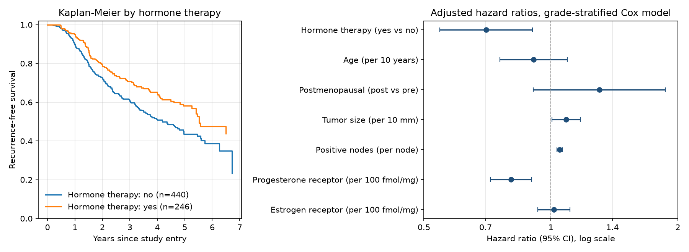

# Clinical-Trial Survival Analysis (GBSG2)

Which factors predict breast cancer recurrence, and is adjuvant hormone therapy associated with longer recurrence-free survival once tumor and patient characteristics are accounted for? This project answers that for the 686 node-positive patients of the German Breast Cancer Study Group 2 trial, with matching implementations in Python, R and SAS.

## Key results

| Result | Estimate | Uncertainty / comparison |
|---|---|---|
| 5-year recurrence-free survival, hormone therapy vs none (Kaplan-Meier) | 58.1% vs 43.7% | 95% CI 50.7 to 64.8% vs 37.8 to 49.4% |
| Log-rank test, hormone therapy | chi-square 8.56, 1 df | p = 0.0034 |
| Log-rank test, tumor grade I/II/III | chi-square 21.09, 2 df | p = 2.6e-5 |
| Adjusted hazard ratio, hormone therapy (grade-stratified Cox) | 0.70 | 95% CI 0.54 to 0.90, p = 0.0063 |
| Hormone therapy HR across four model specifications | 0.63 to 0.71 | every 95% CI excludes 1 |
| Harrell's C, primary model | 0.674 apparent | 0.662 after bootstrap optimism correction (200 resamples) |
| Proportional hazards, global score test | p = 0.0071 with grade as a covariate | p = 0.13 once the baseline hazard is stratified by grade |
| Python vs R parity | coefficients, SEs, C, log-rank, KM and PH tests | agree to at least 6 significant digits (enforced by tests) |



Adjusted hazard ratios from the primary model (`outputs/cox_coefficients.csv`):

| Covariate | Unit | HR (95% CI) | p |
|---|---|---|---|
| Hormone therapy | yes vs no | 0.70 (0.54 to 0.90) | 0.0063 |
| Age | per 10 years | 0.91 (0.76 to 1.09) | 0.31 |
| Menopausal status | post vs pre | 1.30 (0.91 to 1.87) | 0.15 |
| Tumor size | per 10 mm | 1.09 (1.01 to 1.17) | 0.034 |
| Positive lymph nodes | per node | 1.05 (1.03 to 1.06) | 2.4e-10 |
| Progesterone receptor | per 100 fmol/mg | 0.80 (0.72 to 0.90) | 0.00015 |
| Estrogen receptor | per 100 fmol/mg | 1.02 (0.93 to 1.11) | 0.72 |

Hormone therapy sensitivity (`outputs/hormone_therapy_sensitivity.csv`):

| Model | HR (95% CI) |
|---|---|
| Ordinal grade, all terms linear | 0.71 (0.55 to 0.92) |
| Grade-stratified (primary) | 0.70 (0.54 to 0.90) |
| Primary + age, menopausal status and ER x log(t) | 0.71 (0.55 to 0.92) |
| Primary + natural cubic splines for all continuous terms | 0.63 (0.48 to 0.81) |

## Approach

- **Kaplan-Meier estimation and log-rank tests** describe unadjusted recurrence-free survival by hormone therapy and tumor grade, with log-log confidence limits for medians and 5-year survival.
- **Cox proportional hazards regression** (Breslow ties) adjusts for age, menopausal status, tumor size, nodes and hormone receptors. Continuous-term HRs are reported per clinically readable unit.
- **Schoenfeld-residual (Grambsch-Therneau) score tests** on log(time) check proportional hazards. Grade fails (p = 0.0036), so the primary model **stratifies the baseline hazard by grade** instead of forcing one grade HR.
- **Time-varying coefficients** for the terms that still fail (age, menopausal status, estrogen receptor) are fitted on counting-process data split at every event time, the same model as R's `coxph(tt = ...)`.
- **Functional form** is checked with likelihood-ratio tests of natural cubic splines and null-model martingale residual plots. Age, tumor size, nodes and progesterone receptor are nonlinear (p < 0.05), so a spline model is part of the sensitivity set.
- **Discrimination** is measured with Harrell's C, corrected for optimism with Harrell's bootstrap (200 resamples, fixed seed). DFBETAS screen for influential patients.
- **Cross-language validation:** the R script (`survival`) reproduces every Python estimate, and the test suite fails if they drift. The SAS script (`PROC LIFETEST`, `PROC PHREG`) specifies the same models.

## Data

`TH.data::GBSG2` ([documentation](https://rdrr.io/cran/TH.data/man/GBSG2.html), CRAN package `TH.data`, GPL-3), from the German Breast Cancer Study Group 2 trial (Schumacher et al., 1994; Sauerbrei and Royston, 1999). One row per patient: 686 women with node-positive breast cancer, 299 recurrences or deaths and 387 censored, followed for up to 7.3 years. Columns: `horTh` (hormone therapy), `age`, `menostat`, `tsize` (mm), `tgrade` (I to III), `pnodes`, `progrec` and `estrec` (fmol/mg), `time_days` and `event` (1 = recurrence or death). The only change from the source is renaming `time` and `cens`. See [DATA_PROVENANCE.md](DATA_PROVENANCE.md) for the checksum.

## Repository structure

```
analysis.py                 Python pipeline (statsmodels), writes outputs/ and figures/
r/survival_analysis.R       R implementation (survival), writes outputs-r/
sas/survival_analysis.sas   SAS implementation (PROC LIFETEST, PROC PHREG)
survival_analysis.ipynb     Executed walkthrough of the results
tests/test_analysis.py      Invariants and Python/R parity tests
data/gbsg2.csv              GBSG2 data
outputs/  outputs-r/        Generated tables and diagnostics
figures/                    Kaplan-Meier curves and forest plots
```

## Reproduce

```bash
python3.12 -m venv .venv && source .venv/bin/activate
pip install -r requirements.txt
python analysis.py
Rscript r/survival_analysis.R --data data/gbsg2.csv --output-dir outputs-r   # optional, needs R + survival
pytest -q
jupyter nbconvert --to notebook --execute --inplace survival_analysis.ipynb
```

The SAS script needs SAS/STAT 15.1 or later for `CONCORDANCE=`. It hasn't been run here (no SAS license), so its output isn't part of the parity tests.

## Limitations

- Hormone therapy is analyzed as an observed covariate, so its hazard ratio is an adjusted association, not a causal treatment effect.
- Age, menopausal status and estrogen receptor still fail the PH test in the primary model. The time-varying sensitivity model handles them and leaves the hormone therapy estimate unchanged, but the primary HRs for those three terms are time-averaged.
- The primary model keeps linear terms for interpretability even though four continuous covariates are nonlinear. The spline model moves the hormone therapy HR from 0.70 to 0.63, so the linear model is, if anything, conservative for that term.
- One patient with 51 positive nodes shifts the node coefficient by more than 1 SE (DFBETAS 1.18). Results are reported with that patient included.
- The C-index is internally validated only. There is no external cohort.
